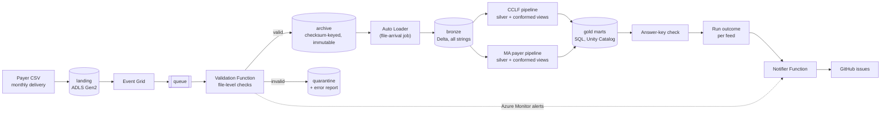

# claims-lakehouse-databricks-azure

**An event-driven claims lakehouse on Azure and Databricks.** Monthly claims and eligibility
files from two payers, CMS CCLF (Medicare fee-for-service) and a fictional Medicare
Advantage payer, flow landing → bronze → silver → gold. **Gold matches the generator's
answer keys exactly for all 36 months**, including deliveries that arrive out of order and
corrected re-sends. All data is synthetic.

**Stack:** PySpark on Databricks serverless, Lakeflow Declarative Pipelines, Auto Loader,
Unity Catalog, Azure Functions, Event Grid, ADLS Gen2, Terraform, Databricks Asset Bundles,
GitHub Actions with OIDC, pytest.

It is the Azure sibling of [claims-lakehouse-dbt-duckdb](https://github.com/fredr171/claims-lakehouse-dbt-duckdb)
(AWS, dbt, DuckDB). Both read the same files from
[synthetic-payer-files](https://github.com/fredr171/synthetic-payer-files) and must reproduce
the same answer keys, so the same design decisions are built twice, each with
platform-native tools.

## Architecture

| Layer | Holds |
|---|---|
| Landing, archive, quarantine | Files as delivered; validated files under checksum-keyed, write-once paths (the audit record); rejected files with an error report |
| Bronze | Every validated delivery, all columns as strings, plus lineage |
| Silver | One pipeline per payer: current deliveries, typed; member history (SCD2); claim families with net paid |
| Gold | Payer-agnostic members, claims, member months and PMPM |

## Results

Run live on Azure, then torn down. Every delivery started its job run through the
archive's file-arrival trigger.

- **Correct:** after all 36 months, gold matched both payers' answer keys: net paid by
  service month, PMPM, member months, claim statuses and the 17 members who switched payers.
- **Recoverable:** a corrected re-send replaced its original, rebuilt member history and
  still matched.
- **Isolated:** a delivery with a duplicate key stopped its payer while the other payer and
  gold refreshed. The notifier opened a GitHub issue, and the corrected re-send closed it.
- **Guarded at the door:** a file with a byte-order mark was quarantined with its report,
  and an Azure Monitor alert opened an issue for its feed.
- **Cheap:** about $5 for all the live runs, on serverless compute.

The run that stopped one payer: `silver_cclf` failed its expectation, the other payer and
gold still ran, and the last task failed the run and reported it.

## Key decisions

The full reasoning, layer by layer, is in [docs/DESIGN.md](docs/DESIGN.md).

1. **Whole files are validated before Auto Loader.** Auto Loader is row-oriented and cannot
   reject a file, so an Azure Function checks each one first (name, encoding, strict CSV,
   exact header, field counts, keys) and Auto Loader only ever reads the archive.
2. **Archive paths are keyed by checksum, and the archive is write-once.** Auto Loader never
   reprocesses a path it has seen, so a corrected re-send under the same name would
   otherwise be dropped. A container-level WORM policy makes the archive, not bronze, the
   audit record.
3. **Silver reads current deliveries only.** The latest delivery of each file wins, by
   archive time, not ingest time. Member history uses AUTO CDC, and a re-send that
   supersedes a member file triggers a full refresh of that payer's pipeline, because AUTO
   CDC cannot retract rows it already applied.
4. **A stop blocks one payer, and only that payer.** Each payer has its own pipeline, and
   every published table depends on a gate table, so a failed expectation leaves that
   payer's last good silver and gold untouched while the other payer refreshes.
5. **Gold learns about payers from one registry.** Each payer supplies conformed views with
   identical columns, code mappings happen there, and the mart SQL never names a payer.
   Onboarding or retiring a payer is a registry change.
6. **Every outcome reaches GitHub, with identifiers and counts only.** The job's last task
   classifies the run per feed, and a notifier Function opens, comments on and closes one
   issue per problem. Names, addresses and birth dates are masked in Unity Catalog and
   never reach gold.

## Testing

496 pytest tests on a local Spark session, with no Azure access. Every check is first shown
to fail on deliberately broken data. The answer-key tests load all 36 months for both payers
and match silver and gold exactly. Loading in random order, in uneven batches or with
re-sends must give the same result as a clean load. CI runs ruff, `terraform validate` and
the fast subset (439 tests) on every pull request. Details are in
[docs/DESIGN.md](docs/DESIGN.md#9-testing).

## Running it

[docs/SETUP.md](docs/SETUP.md) covers the local tests, the Terraform environment, the
Databricks bundle and the GitHub deploy workflow. `infra/teardown.ps1` removes the
environment between live runs.

## How this was built

I designed this project and directed and verified the work. I wrote the code with AI
assistance (Claude Code). Every result above comes from tests or live runs, not from the AI.

## License

[MIT](LICENSE)
