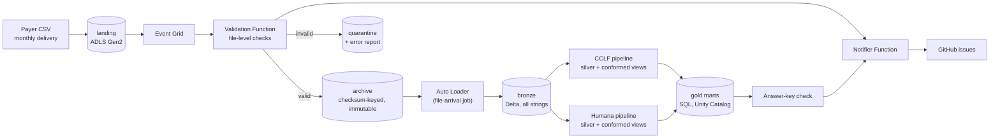

# claims-lakehouse-databricks-azure

An event-driven claims lakehouse on Azure and Databricks. It ingests monthly healthcare claims
deliveries from two payers, CMS CCLF (Medicare fee-for-service) and Humana Medicare Advantage,
through a medallion architecture: landing → bronze → silver → gold.

It is the sibling of [claims-lakehouse-dbt-duckdb](https://github.com/fredr171/claims-lakehouse-dbt-duckdb)
(AWS, Lambda, dbt-duckdb). Both use the same synthetic data from
[synthetic-payer-files](https://github.com/fredr171/synthetic-payer-files) and must reproduce
its **answer keys** (the exact results a correct pipeline produces) exactly. The design
decisions are the same; the stack is platform-native. Where this repo differs, the reason is
below. All data is synthetic.

> **Status:** phase 1 (local foundation) is done: config, file validation, silver and gold
> logic, and tests against both answer keys, all running locally on PySpark. Azure
> infrastructure (phase 2), Databricks pipelines and jobs (phase 3), and the notifier, CI
> and dashboard (phase 4) come next.

**Stack:** Python 3.12, PySpark 4 (Databricks serverless), Lakeflow Declarative Pipelines,
Auto Loader, Unity Catalog, Azure Functions, Event Grid, ADLS Gen2, Terraform, Databricks
Asset Bundles, pytest, ruff.

## Architecture



| Layer | Where | What it holds |
|---|---|---|
| Landing | ADLS Gen2 `landing` | CSVs exactly as delivered |
| Archive | ADLS Gen2 `archive` | Validated files, checksum-keyed, immutable: the audit record |
| Quarantine | ADLS Gen2 `quarantine` | Rejected files plus an error report |
| Bronze | Delta tables | Every validated delivery, all columns as strings, plus lineage |
| Silver | Lakeflow pipeline per payer | Current deliveries, typed; member history (SCD2); claim families with net paid |
| Gold | Delta tables (SQL) | Payer-agnostic members, claims, member months, PMPM |

## Key decisions, layer by layer

### 1. Validation (landing → archive): whole files, before Auto Loader
- Auto Loader is row-oriented and cannot reject a whole file, so a **Python Azure Function
  validates every file first** and Auto Loader only ever sees the archive. Checks, from one
  YAML file per file type: landing path, known file type, file name, size, no BOM, encoding,
  strict CSV parsing, no line breaks inside fields, exact header, field counts, at least one
  row, non-empty keys (`src/claims_lakehouse/validation/`).
- **Every independent check runs**, and checks that depend on a failed one are marked
  skipped, so one error report lists everything wrong with a file. Reports carry check
  names, line numbers and counts, never data values.
- **Differs from the sibling:**
  - **Line breaks inside quoted fields are rejected.** That guarantees one line is one row,
    so bronze can read without multiLine and stay splittable.
  - **A NUL byte fails the encoding check.** A UTF-16 file can otherwise decode as valid UTF-8.
- A valid file is copied to
  `archive/<feed>/<file_type>/delivery_month=<m>/checksum=<sha256>/<file name>`; an identical
  file (same checksum) is skipped. **Checksum-keyed paths are needed for correctness:** Auto
  Loader never reprocesses a path it has seen, so a corrected re-send under the same name
  would otherwise be silently dropped.

### 2. Bronze: every delivery, as delivered
- All columns are strings (codes keep their leading zeros), plus lineage: feed, file type,
  delivery month and checksum from the archive path, source file, archive time, ingest time.
  Append-only.
- **Empty fields become NULL.** Spark's CSV reader cannot keep an empty field as `""` (the
  sibling's bronze keeps `""`). Staging treats both the same, so results do not change.

### 3. Silver: one pipeline per payer, logic in plain PySpark modules
- One Lakeflow pipeline **per payer**, so a failure in one never blocks the other. The
  transformations are importable functions (`src/claims_lakehouse/silver/`) that the pipelines
  call and the tests run locally.
- **Current deliveries only.** A delivery index picks the latest delivery of each file
  (feed, file type, month) and silver reads only those. **Differs from the sibling:** order is
  **archive time** (when the Function archived the file), then checksum, not ingest time,
  because Auto Loader can ingest an original and its re-send in one micro-batch with the same
  ingest time.
- **Staging** renames to names shared across payers (`beneficiary_mbi`, `claim_start_date`),
  turns blanks into NULL and types dates and amounts; codes and IDs stay strings.
- **Member history (SCD2):** a new version only when a tracked attribute changes (CCLF age and
  Humana's file as-of date move every month and are not tracked); the change type (new,
  update, termination) is derived, never read from the file. AUTO CDC will build this table,
  sequenced by delivery month then archive time; `silver/member_history.py` is the batch
  reference that the tests check against the answer keys, and phase 3 checks AUTO CDC's
  table against the same keys.
- **Claim families and net paid:** status comes from which versions are present (CCLF) or
  still active, meaning not reversed (Humana), never from file order. CCLF: any cancellation
  → cancelled, else the latest adjustment by claim load date. Humana: an active replacement
  → replaced, else an active original (paid or denied), else voided.
  **Differs from the sibling:** Humana net paid uses the same status rule as CCLF rather than
  a sum of every version. They agree whenever history is complete (a test checks this). They
  differ only for a reversal whose original never arrived, which nets to 0 instead of a
  negative amount.

#### Supersession: corrected re-sends retract what they replace
AUTO CDC handles out-of-order arrivals, but it cannot retract the changes of a delivery
that a corrected re-send replaced: the original's rows were already applied. The decision:
- **AUTO CDC reads only current deliveries**, so a superseded delivery's rows never reach it
  again.
- **When a re-send supersedes a delivery, the job will run a full refresh of that payer's
  member-history flow** (phase 3), rebuilding it from current deliveries. Re-sends are rare, and the
  rebuild is small (one row per member change).

Claim families and the other silver tables are recomputed from current deliveries anyway.
The local tests prove the outcome: a beneficiary whose only row is removed by a re-send
vanishes, a removed member change is retracted from history, and a removed replacement leaves
its claim voided. Every result equals a clean load of the corrected files.

#### Stop vs warn gating
- **Row expectations** are `(name, SQL constraint, warn | drop | fail)`, the form Lakeflow
  takes (`silver/quality.py`, one definition list per payer). They run on each file's
  current rows **as delivered text**, before typing.
  **Differs from the sibling:** DuckDB's cast fails on a bad value, while Spark's `try_cast`
  is lenient. It reads `2023-1-5` as a date and rounds `12.345` to `12.35`. So formats are
  checked explicitly: exact `YYYY-MM-DD`, exactly two decimals, and a real calendar date.
- **Fail when a value would make silver wrong:**
  - claim keys, and adjustment, frequency, status and form codes;
  - the link from a reversal or replacement to its original;
  - the dates that pick a version or a service month;
  - paid amounts;
  - coverage dates;
  - Humana's MBI.

  Everything else warns.
- **Aggregate rules are per-month gate tables**, not row expectations:
  - **Duplicate keys:** fail.
  - **Humana line amount rules:** any broken line warns; the month stops when more than 1%
    and at least 5 of its lines break a rule (a broken extract, not one odd line).

  Gate tables read every current delivery, so a bad month keeps stopping later runs until a
  corrected re-send replaces it.
- **A stop leaves the payer's last published silver and gold untouched**, and gold still
  refreshes from the other payer. In phase 3 every published table of a payer depends on its
  gate tables, so a failed expectation blocks the whole payer, not just its downstream tables.

### 4. Gold: SQL, and payers plug in through a registry
- The marts are SQL files (`src/claims_lakehouse/gold/sql/`):
  - `dim_payer`
  - `dim_member`: one person per MBI across payers
  - `fct_claims`
  - `fct_member_months`: covered on any day of the month, inside the payer's delivery window
  - `agg_payer_monthly`: PMPM = net paid by service month per member month
  - a reconcile check (stop) that the summary adds up to the facts
- **The payer registry** (`config/payers.yml`) is the only place gold learns about payers.
  Each payer supplies three **conformed views** in SQL: coverage spans, claim families, and
  current deliveries for its delivery window. They have identical columns and types,
  enforced by a contract check. Code mappings such as sex `1`/`2` vs `M`/`F`, `CANCELLED`
  vs `VOIDED`, and `REPLACED` → `ADJUSTED` happen there, never in a mart.
- Mart SQL names its inputs with `${...}` placeholders that a thin renderer fills from the
  registry (where the sibling uses dbt macros), so the same SQL runs locally and on Databricks.
- **Payer lifecycle:**
  - **Onboard:** add the conformed views and a registry entry. The payer shows as
    `awaiting_data` until its first file arrives.
  - **Retire:** set `retired_month`. History stays, but the payer is no longer current coverage.
  - **Offboard:** remove the entry. The payer drops out of every mart.
- No names, addresses or full birth dates in gold. In silver they will be protected with
  Unity Catalog column masks.

## Testing

`pytest` with a local Spark session; no Azure access needed. A local harness stands in for
the Function, archive and Auto Loader (`tests/harness.py`), and for a job run of both payer
pipelines plus gold (`tests/lakehouse.py`). Every check is first shown to fail on
deliberately broken data:
- **Validation:** a broken fixture file for every check (BOM, ragged rows, bad encoding,
  UTF-16, line break in a field, missing keys, ...), with the exact set of failed checks.
- **Expectations:**
  - **Payer expectations:** every one passes on a real delivered row and fails on a copy
    broken to break it. That copy is derived from the expectation's name, so a new
    expectation without one fails the suite.
  - **Thresholds:** tested at their edges.
- **Answer keys** (36 generated months, both payers), all matched exactly:
  - **Silver:** current members, every member change and its derived type, every claim
    action, net paid by service month and by load or processed month, and capitated
    encounters.
  - **Gold:** net paid per payer, the 17 payer switchers in `dim_member`, and member months
    for every month, checked against an independent count from the delivered files.
- **Load order and re-sends:** files delivered in random order across feeds and months, in
  uneven batches, give the same silver and gold as an in-order load. Corrected re-sends give
  the same result as a clean load of the corrected files.
- **Gating:**
  - a warn does not block;
  - a stop holds back its payer while the other refreshes;
  - the stop keeps blocking the next month;
  - re-sends recover to a clean load.
- **Mutation checks:** during development, breaking a rule (adjustment netting, terminations,
  the active-version rule, status mappings, the any-day member-month rule, delivery ordering)
  was confirmed to fail the tests.

Tests that load all 36 months are marked `slow`. The fast subset (CI) runs in about a minute
and a quarter on a Windows laptop.

## Local setup

Requires Python 3.12 and Java 17 (for local Spark). From PowerShell:

```powershell
py -3.12 -m venv .venv
.venv\Scripts\python -m pip install -e ".[dev]"
.venv\Scripts\ruff check .
.venv\Scripts\pytest -m "not slow"   # fast subset, as in CI
.venv\Scripts\pytest                 # everything, including the 36-month answer-key tests
```

Set `JAVA_HOME` to the JDK 17 folder if `java` is not on `PATH`.
