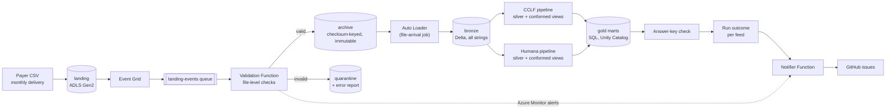
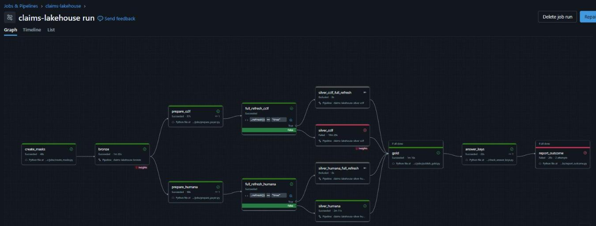
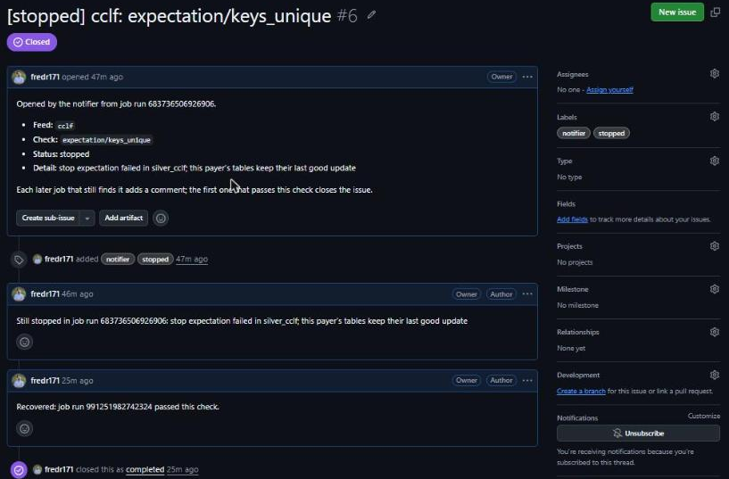
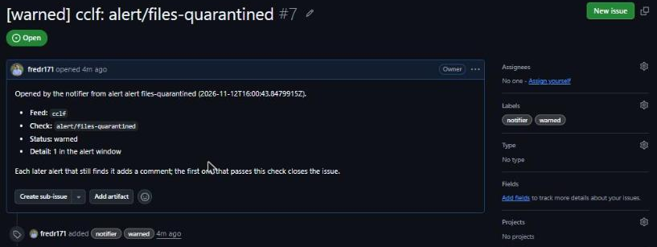
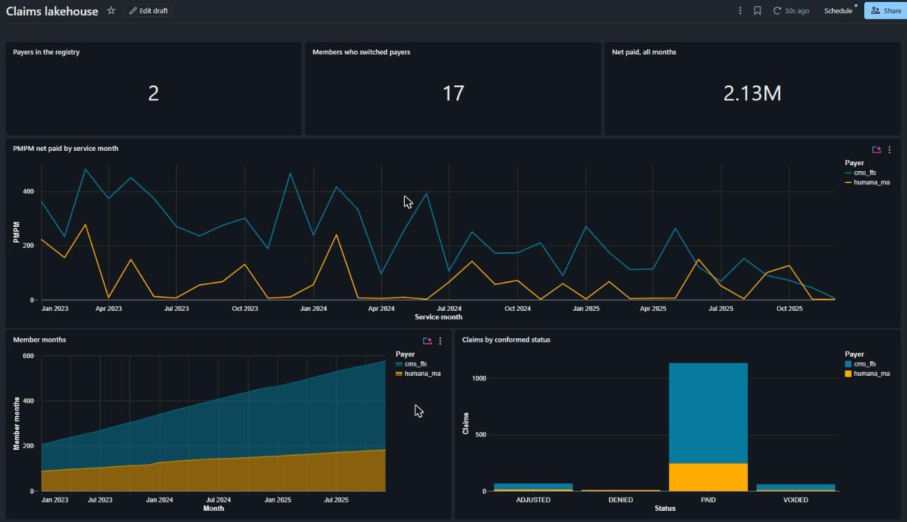

# claims-lakehouse-databricks-azure

An event-driven claims lakehouse on Azure and Databricks. It ingests monthly healthcare claims
deliveries from two payers, CMS CCLF (Medicare fee-for-service) and Humana Medicare Advantage,
through a medallion architecture: landing → bronze → silver → gold.

It is the sibling of [claims-lakehouse-dbt-duckdb](https://github.com/fredr171/claims-lakehouse-dbt-duckdb)
(AWS, Lambda, dbt-duckdb). Both use the same synthetic data from
[synthetic-payer-files](https://github.com/fredr171/synthetic-payer-files) and must reproduce
its **answer keys** (the exact results a correct pipeline produces) exactly. The design
decisions are the same; the stack is platform-native. Where this repo differs, the reason is
below. All data is synthetic.

> **Status:** all four phases are done.
> - **Phase 1:** config, file validation, silver and gold logic, and tests against both
>   answer keys, all running locally on PySpark.
> - **Phase 2:** Terraform for storage, Event Grid, the validation Function, Key Vault and
>   the Databricks workspace. Verified live: a valid file is archived, a broken one is
>   quarantined with its report, a repeat is a duplicate, and the archive refuses deletes.
>   `infra/teardown.ps1` removes all of it.
>
> - **Phase 3:** Unity Catalog, the bronze and per-payer pipelines, gold and the job.
>   Verified live on serverless: gold matches both answer keys for all 36 months, and a
>   corrected re-send takes the full-refresh path and still matches.
> - **Phase 4:** the notifier and GitHub issues, the provided file-events queue for the
>   trigger, CI with an OIDC deploy, and the dashboard. Verified live: every delivery
>   started its run through the trigger; a duplicate-key delivery stopped CCLF while
>   Humana refreshed, opened an issue, and a corrected re-send closed it; a quarantined
>   file opened an alert issue; and after all 36 months gold matched both answer keys.

**Stack:** Python 3.12, PySpark 4 (Databricks serverless), Lakeflow Declarative Pipelines,
Auto Loader, Unity Catalog, Azure Functions, Event Grid, ADLS Gen2, Terraform, Databricks
Asset Bundles, pytest, ruff.

## Architecture



| Layer | Where | What it holds |
|---|---|---|
| Landing | ADLS Gen2 `landing` | CSVs exactly as delivered |
| Archive | ADLS Gen2 `archive` | Validated files, checksum-keyed, immutable: the audit record |
| Quarantine | ADLS Gen2 `quarantine` | Rejected files plus an error report |
| Bronze | Delta tables | Every validated delivery, all columns as strings, plus lineage |
| Silver | Lakeflow pipeline per payer | Current deliveries, typed; member history (SCD2); claim families with net paid |
| Gold | Delta tables (SQL) | Payer-agnostic members, claims, member months, PMPM |

## Key decisions, layer by layer

### 1. Validation (landing → archive): whole files, before Auto Loader
- Auto Loader is row-oriented and cannot reject a whole file, so a **Python Azure Function
  validates every file first** and Auto Loader only ever sees the archive. Checks, from one
  YAML file per file type: landing path, known file type, file name, size, no BOM, encoding,
  strict CSV parsing, no line breaks inside fields, exact header, field counts, at least one
  row, non-empty keys (`src/claims_lakehouse/validation/`).
- **Every independent check runs**, and checks that depend on a failed one are marked
  skipped, so one error report lists everything wrong with a file. Reports carry check
  names, line numbers and counts, never data values.
- **Differs from the sibling:**
  - **Line breaks inside quoted fields are rejected.** That guarantees one line is one row,
    so bronze can read without multiLine and stay splittable.
  - **A NUL byte fails the encoding check.** A UTF-16 file can otherwise decode as valid UTF-8.
- A valid file is copied to
  `archive/<feed>/<file_type>/delivery_month=<m>/checksum=<sha256>/<file name>`; an identical
  file (same checksum) is skipped. **Checksum-keyed paths are needed for correctness:** Auto
  Loader never reprocesses a path it has seen, so a corrected re-send under the same name
  would otherwise be silently dropped.
- **Handling is idempotent**, because Event Grid delivers at least once
  (`src/claims_lakehouse/validation/landing.py`).
  - **Archiving never overwrites.** The archive write is a single create-if-absent call,
    so a repeated event is recorded as a duplicate.
  - **Quarantine writes are repeatable.** They overwrite, so a retried rejection rewrites
    the same file and report.
  - **The file read must match the event.** It must still have the event's ETag. If a payer
    replaced the file in landing first, the newer upload has its own event.

  The Function in `functions/validation/` is only a queue trigger around this handler and
  an Azure SDK implementation of its storage interface.
- **The archive is write-once.** A container-level time-based immutability (WORM) policy stops
  any archived delivery from being overwritten or deleted during retention, so the archive,
  not bronze, is the audit record. The lake has a hierarchical namespace, which Unity Catalog
  requires and which rules out blob versioning, so container-level WORM is the protection
  available. The policy is left unlocked so the dev environment can be torn down; production
  would lock it.

### 2. Bronze: every delivery, as delivered
- All columns are strings (codes keep their leading zeros), plus lineage: feed, file type,
  delivery month and checksum from the archive path, source file, archive time, ingest time.
  Append-only.
- **Auto Loader reads only the archive**, one streaming table per file type
  (`src/pipelines/bronze.py`), with the same CSV options, schema and lineage the local tests
  use. Archive time is the file's modification time from `_metadata`. The archive is a
  **read-only** external location: Databricks can never change the audit record, and
  `cleanSource` is never used. A path outside the archive layout (no month or checksum)
  fails the update rather than loading rows without lineage.
- **Empty fields become NULL.** Spark's CSV reader cannot keep an empty field as `""` (the
  sibling's bronze keeps `""`). Staging treats both the same, so results do not change.

### 3. Silver: one pipeline per payer, logic in plain PySpark modules
- One Lakeflow pipeline **per payer**, so a failure in one never blocks the other. The
  transformations are importable functions (`src/claims_lakehouse/silver/`) that the pipelines
  call and the tests run locally.
- **Each payer's tables are listed once, as data** (`silver/<payer>/tables.py`): name,
  inputs, build function, expectations, and whether it is published. The local build walks
  that list, and the one pipeline file both payers run (`src/pipelines/silver.py`) defines
  a materialized view per entry, so the two cannot drift. A local runner executes the
  pipeline file with a stand-in for `pyspark.pipelines`, and its published tables must
  equal the local build.
- **Current deliveries only.** A delivery index picks the latest delivery of each file
  (feed, file type, month) and silver reads only those. **Differs from the sibling:** order is
  **archive time** (when the Function archived the file), then checksum, not ingest time,
  because Auto Loader can ingest an original and its re-send in one micro-batch with the same
  ingest time.
- **Staging** renames to names shared across payers (`beneficiary_mbi`, `claim_start_date`),
  turns blanks into NULL and types dates and amounts; codes and IDs stay strings.
- **Member history (SCD2):** a new version only when a tracked attribute changes (CCLF age and
  Humana's file as-of date move every month and are not tracked); the change type (new,
  update, termination) is derived, never read from the file. On Databricks, **AUTO CDC**
  (SCD type 2) builds the history, sequenced by delivery month then archive time, and
  `versions_from_history()` turns its output into the same columns as the batch reference
  (`silver/member_history.py`) that the tests check against the answer keys. AUTO CDC runs
  only on Databricks, so a small Python model of its semantics stands in for it locally;
  the converted result must equal the batch reference, including a member whose months
  arrive out of order.
- **Claim families and net paid:** status comes from which versions are present (CCLF) or
  still active, meaning not reversed (Humana), never from file order. CCLF: any cancellation
  → cancelled, else the latest adjustment by claim load date. Humana: an active replacement
  → replaced, else an active original (paid or denied), else voided.
  **Differs from the sibling:** Humana net paid uses the same status rule as CCLF rather than
  a sum of every version. They agree whenever history is complete (a test checks this). They
  differ only for a reversal whose original never arrived, which nets to 0 instead of a
  negative amount.

#### Supersession: corrected re-sends retract what they replace
AUTO CDC handles out-of-order arrivals, but it cannot retract the changes of a delivery
that a corrected re-send replaced: the original's rows were already applied. The decision:
- **AUTO CDC reads only current deliveries**, so a superseded delivery's rows never reach it
  again.
- **When a re-send supersedes a member-file delivery, the job full-refreshes that payer's
  pipeline**, rebuilding history from current deliveries. Each run starts with a small task
  that counts superseded member-file deliveries in bronze and compares that with the count
  the pipeline published when it last succeeded. If the count grew, a condition task picks
  the full-refresh branch. Re-sends are rare, the rebuild is small (one row per member
  change), and the other silver tables are materialized views that recompute anyway. The
  whole payer pipeline is refreshed, not just the history flow, because a job's pipeline
  task can only full-refresh a whole pipeline.

Claim families and the other silver tables are recomputed from current deliveries anyway.
The local tests prove the outcome: a beneficiary whose only row is removed by a re-send
vanishes, a removed member change is retracted from history, and a removed replacement leaves
its claim voided. Every result equals a clean load of the corrected files.

#### Stop vs warn gating
- **Row expectations** are `(name, SQL constraint, warn | drop | fail)`, the form Lakeflow
  takes (`silver/quality.py`, one definition list per payer). They run on each file's
  current rows **as delivered text**, before typing.
  **Differs from the sibling:** DuckDB's cast fails on a bad value, while Spark's `try_cast`
  is lenient. It reads `2023-1-5` as a date and rounds `12.345` to `12.35`. So formats are
  checked explicitly: exact `YYYY-MM-DD`, exactly two decimals, and a real calendar date.
- **Fail when a value would make silver wrong:**
  - claim keys, and adjustment, frequency, status and form codes;
  - the link from a reversal or replacement to its original;
  - the dates that pick a version or a service month;
  - paid amounts;
  - coverage dates;
  - Humana's MBI.

  Everything else warns.
- **Aggregate rules are per-month gate tables**, not row expectations:
  - **Duplicate keys:** fail.
  - **Humana line amount rules:** any broken line warns; the month stops when more than 1%
    and at least 5 of its lines break a rule (a broken extract, not one odd line).

  Gate tables read every current delivery, so a bad month keeps stopping later runs until a
  corrected re-send replaces it.
- **A stop leaves the payer's last published silver and gold untouched**, and gold still
  refreshes from the other payer. In the pipeline, a one-row `_gate` table depends on every
  table with a fail expectation, and every published table (member history, claim
  families, the conformed views) joins it. A failed expectation therefore blocks the whole
  payer, not just its downstream tables. Tests confirm that nothing is published without
  the gate.

### 4. Gold: SQL, and payers plug in through a registry
- The marts are SQL files (`src/claims_lakehouse/gold/sql/`):
  - `dim_payer`
  - `dim_member`: one person per MBI across payers
  - `fct_claims`
  - `fct_member_months`: covered on any day of the month, inside the payer's delivery window
  - `agg_payer_monthly`: PMPM = net paid by service month per member month
  - a reconcile check (stop) that the summary adds up to the facts
- **The payer registry** (`config/payers.yml`) is the only place gold learns about payers.
  Each payer supplies three **conformed views** in SQL: coverage spans, claim families, and
  current deliveries for its delivery window. They have identical columns and types,
  enforced by a contract check. Code mappings such as sex `1`/`2` vs `M`/`F`, `CANCELLED`
  vs `VOIDED`, and `REPLACED` → `ADJUSTED` happen there, never in a mart.
- Mart SQL names its inputs with `${...}` placeholders that a thin renderer fills from the
  registry (where the sibling uses dbt macros), so the same SQL runs locally and on Databricks.
- **Payer lifecycle:**
  - **Onboard:** add the conformed views and a registry entry. The payer shows as
    `awaiting_data` until its first file arrives.
  - **Retire:** set `retired_month`. History stays, but the payer is no longer current coverage.
  - **Offboard:** remove the entry. The payer drops out of every mart.
- **No names, addresses or full birth dates in gold** (only birth year). Where they exist, in
  bronze and silver, **Unity Catalog column masks** protect them
  (`claims_lakehouse/silver/masks.py`):
  - Every table that holds one declares it with a mask, under its delivered name (bronze,
    `*_current`) or its staged name (staging, member history). A reader outside the PII
    readers group sees `[masked]` for text and NULL for a date.
  - **The pipelines and the job run as a service principal that is in the group**, so
    silver and gold are computed from real values while people querying the tables see
    masked ones. Without that, a mask would also hide the values from the tables built
    downstream, and member history would break.
  - **Checked live:** the deployer has SELECT on bronze, silver and gold but is not a PII
    reader. Querying member history shows `[masked]` names and addresses and NULL birth
    dates, while the address changes behind each UPDATE version were still detected. The
    grant goes to the user directly: Unity Catalog grants need a user or an account-level
    group, and the PII readers group is workspace-local (masks check it with `is_member`).
  - Lakeflow takes a mask only as part of a table's full schema, so the schemas are derived
    from the tables' own build functions run on empty inputs, never written by hand. A test
    requires each declared schema to equal the schema of the table built from real data.
    That test caught a type the AUTO CDC conversion produced differently (int vs bigint).
  - The mask functions are created by the job's first task, because Terraform has no
    resource for SQL functions.
- **On Databricks**, each payer pipeline publishes its conformed views in its own schema
  (`silver_cclf`, `silver_humana`). The gold task renders the same mart SQL against those
  Unity Catalog names and writes the marts as tables in `gold`. A registered payer whose
  pipeline has not published yet is left out.

### 5. Orchestration: one job, started by the archive
The job is a Databricks Asset Bundle (`databricks.yml`, `resources/`):

```
file arrives ─► create_masks ─► bronze ─┬─► prepare_cclf ──► full refresh? ─► silver_cclf ───┐
in archive                              └─► prepare_humana ► full refresh? ─► silver_humana ─┴─► gold ─► answer_keys
                                                                                                        │
                                                                         report_outcome (always) ◄──────┘
```

- **File-arrival trigger on the archive**, so the job sees only validated files. It waits
  for a quiet period before starting, so one month's files usually make one run. One run at
  a time.
  The trigger reads Unity Catalog **file events** on the archive rather than listing it.
  **Terraform provides the queue** (`eventgrid.tf`): the lake's Event Grid system topic sends
  the archive's blob events to a storage queue, and the access connector may only read that
  one queue. In its automatic mode Databricks creates the subscription and queue itself,
  which needs Storage Account Contributor on the lake. In the first live run that setup
  failed with a storage `AuthorizationFailure` and then stayed "being provisioned"; the
  likely cause is that it uses account keys, which this account disables. Providing the
  queue removes both management roles and the dependency on keys. In the phase 4 live run
  all four deliveries (two batches, a broken file and its re-send) started a run this way,
  a few minutes after the last file arrived.
- **Gold runs even when a payer stopped** (`run_if: ALL_DONE`): the stopped payer's tables
  keep their last good update, and the run still ends failed.
- **The last task compares gold with the answer keys** (`claims_lakehouse/checks/`) and
  fails the run on any mismatch: net paid by service month, PMPM totals, member months,
  conformed claim statuses, the 17 payer switchers, and mart reconciliation. A mismatch is
  reported as a check name and counts, never data values. The keys describe the complete
  36-month delivery, so until the last month has arrived the task reports how many months
  are missing and passes.
- **Serverless everywhere**: the pipelines and the Python tasks. Terraform owns the
  workspace and every Unity Catalog object (storage credential, external locations,
  catalog, schemas, the answer-key volume, the runner service principal, the PII readers
  group, and the runner's grants); the bundle owns only code-level resources.
- **The last task reports the outcome to the notifier** (always runs: `run_if: ALL_DONE`).
  See [the notifier](#7-notifier-one-github-issue-per-problem).
- **The runner has only what it needs:**
  - read files on the archive (nothing can write it);
  - create and refresh tables in the data schemas;
  - create the mask functions and read the answer keys in `ops`.

### 6. Infrastructure: Terraform, keyless, torn down between runs
- **Terraform** (`infra/terraform/`) owns everything, in Central US and tagged
  `project = claims-lakehouse-azure`. Names are defined once in `locals.tf`. Remote state
  lives in a separate account that `infra/bootstrap/bootstrap-state.ps1` creates, so
  `terraform destroy` never touches it.
- **Teardown is a script, not just `terraform destroy`.** With Unity Catalog enabled
  automatically, Azure Databricks adds a workspace-catalog storage account and access
  connector to the workspace's managed resource group, and leaves that group behind when
  the workspace is deleted. `infra/teardown.ps1` runs `destroy`, then deletes the group
  only if it is still marked as managed by this environment's (now deleted) workspace.
- **No storage keys anywhere.** Both storage accounts disable shared-key access, and the
  Function, Event Grid and Databricks reach storage through managed identities with
  narrow roles.
- **Event Grid delivers to a storage queue, not straight to the Function.** The subscription
  can then be created before any Function code exists, events wait while the Function is
  redeployed, and failed deliveries go to a dead-letter container. On an ADLS Gen2 account
  a file is created empty and then flushed, so the subscription passes only the calls that
  finish a file (`FlushWithClose`, `PutBlob`, `PutBlockList`, `CopyBlob`).
- **Both Functions run on Flex Consumption** (Python 3.12), billed per execution, one
  plan each (Flex allows one app per plan). The apps are defined with the `azapi` provider: azurerm's Flex Consumption resource always
  adds a key-based `AzureWebJobsStorage` connection string
  ([hashicorp/terraform-provider-azurerm#29149](https://github.com/hashicorp/terraform-provider-azurerm/issues/29149)),
  which a keyless storage account rejects.
- **CI and deployment** (`.github/workflows/`):
  - **`ci`** runs on every pull request: ruff, `terraform fmt` and `validate`, and the fast
    tests on a local Spark session. No Azure access.
  - **`deploy`** is started by hand and deploys code only: both Functions and the bundle. It
    signs in with **OIDC**: GitHub issues a short-lived token for a run in the `dev`
    environment, and a federated credential on an Entra ID application
    (`github_oidc.tf`) trusts it, so no Azure secret is stored in GitHub. That identity may
    zip-deploy the two Function apps and deploy the bundle, and nothing else.
    Infrastructure stays a reviewed local `terraform apply`.
- **Kept inside a ~$25/month budget:**
  - **Serverless compute** for jobs, pipelines and SQL.
  - **No NAT gateway in Databricks.** Classic clusters get public IPs (with no inbound ports
    open) rather than the NAT gateway that secure cluster connectivity would add on the
    default network, which alone would cost more than the budget. Production would use VNet
    injection.
  - **A daily cap on Log Analytics.**
  - **Key Vault without purge protection,** so the environment can be destroyed and
    rebuilt under the same names.

### 7. Notifier: one GitHub issue per problem
Every job run and every Azure Monitor alert reaches the notifier Function, which keeps one
GitHub issue per problem: it opens the issue, comments while the problem persists, and
closes it when a later run or alert passes that check.

- **Job runs:** the job's last task (`report_outcome`, always run) classifies the run per
  feed (`claims_lakehouse/jobs/outcome.py`) from its task states, each payer's pipeline
  event log and the answer-key result, and posts the report:
  - **warned:** a warn or drop expectation failed rows;
  - **stopped:** a stop expectation failed the payer's update (its tables keep their last
    good version);
  - **error:** any other failed task, or gold differing from the answer keys.
  The task then fails the run if anything stopped or errored, so a run is never marked as
  succeeded because its last task passed.
- **Issues are keyed by the feed the failing check reads**, plus the source and the check
  (`job/cclf/expectation/keys_unique`), in a hidden marker in the issue body. A run closes
  only issues for checks it ran to completion: a run that failed in bronze leaves the
  payers' issues open, and one payer recovering never closes the other's.
- **Azure Monitor alerts** (common alert schema, through an action group):
  - **quarantined files:** one alert per feed (a log alert split by the `feed` the
    validation Function logs). It does not resolve itself, because a quiet window does not
    mean the payer re-sent the file;
  - **validation Function failures:** resolves itself after a clean window, which closes
    the issue.
- **Identifiers and counts only.** Pipeline errors can quote rows, so only expectation names
  are taken from them, by pattern; alert IDs (which contain the subscription) are dropped.
- **Credentials:** the GitHub token is a fine-grained token with issue access to this
  repository only, stored in Key Vault and read through a Key Vault reference. The job finds
  the notifier's URL, with its function key, in a Databricks secret scope that only the
  runner can read.
- **No retries for a stop.** A stop is a data problem, so retrying cannot fix it. The
  live run showed serverless retrying twice over: the stopped pipeline update four times
  (about ten billed minutes), and `report_outcome`, which fails on purpose, once (a second
  "still stopped" comment). The silver pipelines set `pipelines.numUpdateRetryAttempts: 0`
  and the task sets `max_retries: 0`; the job's run repair covers a transient failure.

The live run: `scripts/live_run.py break claims_header 2023-06` sent a file with a
duplicated row. It passed file validation, CCLF stopped on `keys_unique` while Humana
refreshed, gold still ran, and the run failed:



The notifier opened an issue, and `resend` (the same records, a new checksum) closed it.
The duplicate "still stopped" comment is the retry described above:



A file with a byte-order mark was quarantined, and the alert opened an issue for its feed.
It stays open until someone closes it, once the payer has re-sent the file:



### 8. Dashboard and saved queries
- **Saved queries** (`queries/`): PMPM by payer and month, member months, payer switchers,
  the claim status mix and payer deliveries, in Databricks SQL over gold.
- **An AI/BI dashboard** (`resources/dashboards/`), deployed with the bundle, on the
  workspace's serverless starter warehouse. Its datasets are the saved queries verbatim,
  and viewers query with their own permissions (`embed_credentials: false`).
- **Tested like the rest:** every saved query runs on the local gold built from the 36
  months and agrees with the answer keys (17 switchers; member months match `agg_payer_monthly`),
  and a test fails if a dashboard dataset drifts from its saved query.



## Testing

`pytest` with a local Spark session; no Azure access needed. A local harness stands in for
the Function, archive and Auto Loader (`tests/harness.py`), and for a job run of both payer
pipelines plus gold (`tests/lakehouse.py`). Every check is first shown to fail on
deliberately broken data:
- **Validation:** a broken fixture file for every check (BOM, ragged rows, bad encoding,
  UTF-16, line break in a field, missing keys, ...), with the exact set of failed checks.
- **Expectations:**
  - **Payer expectations:** every one passes on a real delivered row and fails on a copy
    broken to break it. That copy is derived from the expectation's name, so a new
    expectation without one fails the suite.
  - **Thresholds:** tested at their edges.
- **Answer keys** (36 generated months, both payers), all matched exactly:
  - **Silver:** current members, every member change and its derived type, every claim
    action, net paid by service month and by load or processed month, and capitated
    encounters.
  - **Gold:** net paid per payer, the 17 payer switchers in `dim_member`, and member months
    for every month, checked against an independent count from the delivered files.
- **Load order and re-sends:** files delivered in random order across feeds and months, in
  uneven batches, give the same silver and gold as an in-order load. Corrected re-sends give
  the same result as a clean load of the corrected files.
- **Gating:**
  - a warn does not block;
  - a stop holds back its payer while the other refreshes;
  - the stop keeps blocking the next month;
  - re-sends recover to a clean load.
- **Pipelines and the job:**
  - the pipeline file defines every listed table with its expectations;
  - its published tables equal the local build, including after a corrected re-send;
  - nothing is published without the gate;
  - AUTO CDC's converted history equals the batch reference;
  - the pipeline's supersession count agrees with the job's count;
  - the answer-key check passes on the full load and reports each of five kinds of broken
    gold.
- **Notifier:** the issue lifecycle on a fake tracker (open, comment, close; scope rules;
  alert and job issues kept apart), classifying runs per feed, and the GitHub client against
  a fake API.
- **Mutation checks:** during development, breaking a rule (adjustment netting, terminations,
  the active-version rule, status mappings, the any-day member-month rule, delivery ordering)
  was confirmed to fail the tests.

Tests that load all 36 months are marked `slow`. The fast subset (CI) runs in about a minute
and a quarter on a Windows laptop.

## Local setup

Requires Python 3.12 and Java 17 (for local Spark). From PowerShell:

```powershell
py -3.12 -m venv .venv
.venv\Scripts\python -m pip install -e ".[dev]"
.venv\Scripts\ruff check .
.venv\Scripts\pytest -m "not slow"   # fast subset, as in CI
.venv\Scripts\pytest                 # everything, including the 36-month answer-key tests
```

Set `JAVA_HOME` to the JDK 17 folder if `java` is not on `PATH`.

### Infrastructure

Requires Terraform 1.9+ and the Azure CLI, signed in with `az login`. Choose a suffix of 3–7
lowercase letters or digits; it makes the storage and Key Vault names globally unique.

```powershell
./infra/bootstrap/bootstrap-state.ps1 -Suffix <suffix>   # once: remote-state account
Copy-Item infra/terraform/terraform.tfvars.example infra/terraform/terraform.tfvars  # set suffix
$env:ARM_SUBSCRIPTION_ID = az account show --query id -o tsv
cd infra/terraform
terraform init "-backend-config=backend.hcl"
terraform plan
terraform apply      # creates billable resources
cd ../..; ./infra/teardown.ps1   # between live runs: destroy, plus the Databricks leftovers
```

Deploy both Functions after `apply` (dependencies install in a remote build):

```powershell
foreach ($app in 'validation', 'notifier') {
    ./functions/build.ps1 -App $app
    $fn = terraform -chdir=infra/terraform output -raw "${app}_function_name"
    az functionapp deployment source config-zip -g rg-claims-lakehouse-dev -n $fn `
        --src "build/$app.zip" --build-remote true
}
```

The notifier needs a GitHub token in Key Vault: a fine-grained personal access token for
this repository only, with read and write access to issues. Paste it when prompted, so it
never appears in the shell history:

```powershell
$kv = terraform -chdir=infra/terraform output -raw key_vault_name
$name = terraform -chdir=infra/terraform output -raw github_token_secret
$token = Read-Host -AsSecureString 'GitHub token'
az keyvault secret set --vault-name $kv -n $name --value ([pscredential]::new('x', $token).GetNetworkCredential().Password) -o none
```

### Deploying from GitHub

After `terraform apply`, the `deploy` workflow can replace the manual Function and bundle
deploys. Create a `dev` environment in the repository settings and set its variables from
Terraform (none are secrets; none are committed):

| Variable | Value |
|---|---|
| `AZURE_CLIENT_ID` | `terraform output -raw github_deploy_client_id` |
| `AZURE_TENANT_ID`, `AZURE_SUBSCRIPTION_ID` | `az account show --query "[tenantId, id]"` |
| `RESOURCE_GROUP` | `terraform output -raw resource_group_name` |
| `VALIDATION_FUNCTION`, `NOTIFIER_FUNCTION` | `terraform output -raw validation_function_name` / `notifier_function_name` |
| `DATABRICKS_HOST` | `terraform output -raw databricks_workspace_url` |
| `ARCHIVE_URL`, `RUNNER_APPLICATION_ID` | `terraform output -raw archive_url` / `runner_application_id` |

Then run it with `gh workflow run deploy`.

### Databricks

Requires the Databricks CLI (`winget install Databricks.DatabricksCLI`). It signs in with
the Azure CLI login, and takes the workspace and archive from the environment:

```powershell
$env:DATABRICKS_HOST = terraform -chdir=infra/terraform output -raw databricks_workspace_url
$env:BUNDLE_VAR_archive_url = terraform -chdir=infra/terraform output -raw archive_url
$env:BUNDLE_VAR_runner_application_id = terraform -chdir=infra/terraform output -raw runner_application_id
databricks bundle validate
databricks bundle deploy   # creates the pipelines and the job (billable when they run)
```
